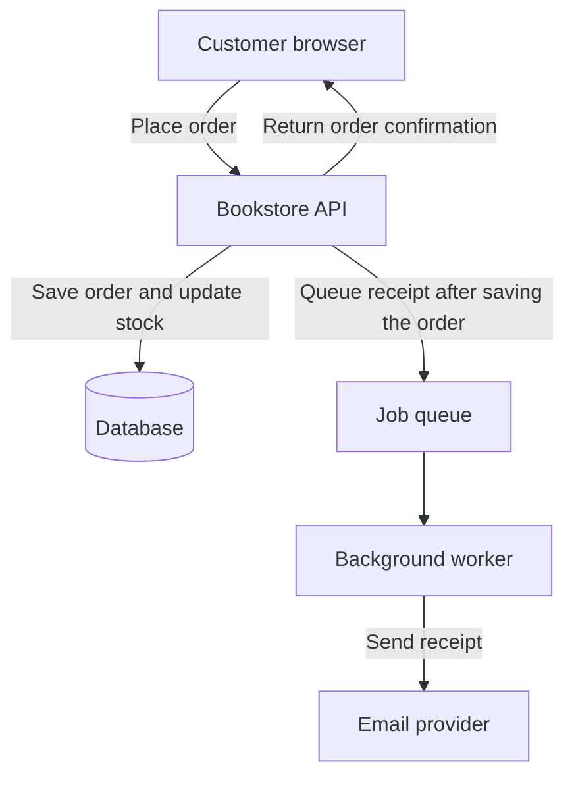

# Backend Engineering from First Principles — The Roadmap

*Post 1 of 31 · [Series index](README.md)*

I’m brushing up on backend fundamentals for an entry-level developer interview. My plan was to spend an evening reviewing HTTP. I now have a table of contents for 31 blog posts. The evening is going well, provided we’re flexible about what it was for.

There’s a good reason to write things down. I can read an explanation of database transactions, nod at the right moments, and come away feeling that I understand them. Ask me what happens when two people try to buy the last copy of a book, though, and I suddenly have several questions about the bookstore.

Suppose both customers click **Place order** at the same time. Both requests see one copy in stock. Which order goes through? What does the other customer see? And if the confirmation email fails, have we sold a book or merely had a difficult afternoon?

I’m using Sriniously’s [Backend from First Principles roadmap](https://www.youtube.com/watch?v=0Rwb4Xmlcwc) to work through those questions. This post is the roadmap. In the next one, I’ll follow a single request from the browser to the database and back. One request seems manageable, which is also what I thought about reviewing HTTP.

## What happens after you click Place order?

The database records the order. A background worker sends the receipt, so the checkout response can return while the email is still on its way.

## Follow one request

A framework can route a request, parse JSON, or open a database connection in a few lines of code. When something breaks, you need to know which of those steps failed. A browser that sends the wrong HTTP method, a server that rejects a malformed body, and a database that times out can all leave a customer staring at the same error screen.

We’ll start with the path from browser to server and back. Then we’ll look at HTTP, routing, and serialization before asking what the server can trust. Authentication establishes who is calling. Authorization determines which records that person may access. Validation checks whether the request contains values the application can use. Middleware, request context, and controllers give each of those responsibilities a place in the application.

## Build an API around rules that hold up

A bookstore can expose an endpoint for placing orders in a few lines. Making it safe to use under real traffic requires more thought. If two requests both read an inventory count of one before either writes, both can appear to succeed. We’ll use that race to explore what a transaction guarantees and which rules the database should enforce.

The same store will give us examples for CRUD, REST design, and business logic. We’ll ask which operations should be exposed, how to return predictable errors, and where to put a purchasing rule so it applies whether the order came from a customer or a staff tool. When we get to caching, we’ll compare the consequences of showing a slightly stale book description with showing stale inventory at checkout.

## Separate checkout from work that can happen later

The bookstore needs to record a successful order before confirming it. Sending the receipt can happen afterward. A background worker can retry an email when the provider is unavailable, but it needs a way to handle the same job more than once without sending duplicate receipts. We’ll use that example to cover transactional email, queues, and scheduling together.

Search presents a different problem. A shopper may type part of a title, misspell a word, or look for books by subject. We’ll explore how a search index supports those queries and what happens when the index temporarily falls behind the catalog.

## Learn to operate the system

Once people use the store, the hardest questions often come from production. A checkout is slow. A new deployment starts while someone is placing an order. A service stops responding after accepting work. We’ll look at error handling, configuration, observability, graceful shutdown, and security through situations like these. Then we’ll use measurements to reason about performance, scaling, concurrency, and parallelism.

The final stretch covers large files, real-time updates, testing, the Twelve-Factor App, OpenAPI, webhooks, and DevOps. Each topic extends the same system. Book covers need storage, order status needs a way to reach customers, integrations need contracts, and deployments need a repeatable way to get tested code into production.

## Where we start

Before we worry about two customers competing for the last copy, let’s follow one person opening a book page. Post 2 traces that request from the browser to the application and database, then back to the screen.

[View all 31 posts in the series index](README.md).
