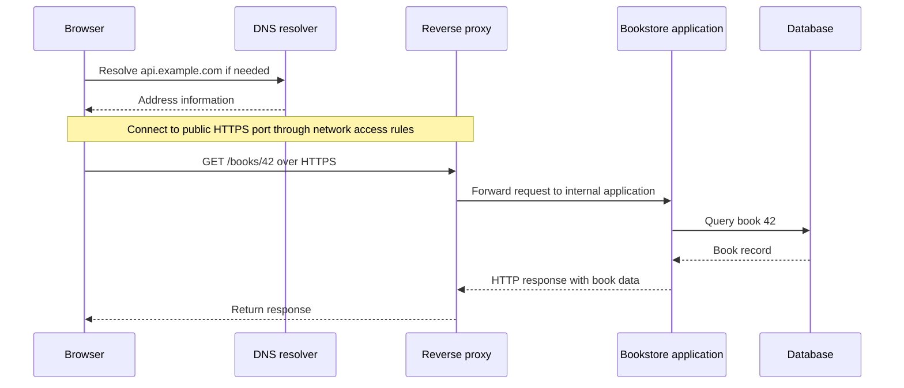

# How a Backend Works — A Bookshop Behind the Button

*Post 2 of 31 · [Series index](README.md) · [Previous post](01-the-roadmap.md)*

Opening a book page feels like a modest request. A title, an author, perhaps a cover. Somewhere, a computer should be able to arrange this without forming a committee.

The committee has already formed. It includes a browser, a name lookup, network access rules, a web server, an application, and possibly a database. Each has a fairly specific job. Understanding those jobs makes backend development much easier to reason about, especially when the page refuses to open and everyone would prefer to blame the Wi-Fi.

This article follows one request through our fictional bookstore. It builds on Sriniously’s third lesson, which demonstrates an AWS deployment and explains why applications need backend services. The bookstore examples and technical clarifications below are my own study explanations.

## A server has more than one meaning

We use **server** for both a computer and a program running on it. That becomes confusing when several programs share the same computer.

Imagine a machine running a bookstore application. The machine supplies CPU, memory, storage, and networking. An application process listens for requests on a port. Its code decides what to do when a customer asks for a book.

The request might ask for an HTML page, an image, or structured data such as JSON. The response carries a status, headers, and usually some content. A backend can also receive data and change application state, such as recording a new order.

## Follow a request for one book

Suppose the browser asks for `https://api.example.com/books/42`. These names and identifiers are illustrative.

DNS supplies address information. The browser then connects to the destination. The HTTP request does not travel through the DNS server on its way to the application. Cached DNS information can also make a new lookup unnecessary.

An **A record** associates a hostname with an IPv4 address. A **CNAME record** makes one hostname an alias of another. The port identifies the service endpoint at the destination. Conventional ports include 80 for HTTP and 443 for HTTPS.

Network rules must permit the connection. On EC2, a security group controls allowed incoming and outgoing traffic. An application can be running perfectly behind a rule that prevents anyone from reaching it. Its confidence is admirable but commercially unhelpful.

## Why another server sits in front

A reverse proxy receives public requests and forwards them to an application. Nginx is a common choice. For our bookstore, it could accept HTTPS traffic and send the application request to `127.0.0.1:3001`.

That address is local to the machine running Nginx. It lets the public entry point and application process use different ports.

**Proxying and redirecting are different operations.** Proxying forwards work internally and returns the upstream response. A redirect tells the browser to make another request to a different URL. Moving an HTTP visitor to HTTPS is a redirect. Forwarding an HTTPS request to the bookstore process is proxying.

The lesson also introduces Certbot for certificate management and PM2 for managing Node.js processes. These are useful examples of deployment tools. Their responsibilities are distinct from the bookstore’s rules for finding books or accepting orders.

## The application gives the request meaning

Once the request reaches the bookstore process, application code interprets `/books/42`, retrieves the appropriate record, and constructs a response. If the book does not exist, the application needs to express that outcome too.

Now consider placing an order. The application must establish who is buying, check the requested items, enforce purchasing rules, and save the result. A button can start this operation, but changing the button’s appearance does not record a sale.

Persistent state lets another session, another device, and the store’s staff see the same order later. A database commonly stores that shared state. The database and application may run on separate machines, and a larger backend may contain several services.

## The browser runs a different part of the application

The browser downloads HTML and supporting resources such as CSS, JavaScript, images, and fonts. It interprets the page, applies styles, and executes browser-side JavaScript for interactions.

For the bookstore, that JavaScript might open a basket panel or request the latest book data. The backend performs its own work in its server environment and returns results.

Modern applications can also generate HTML on the server. Serving a frontend therefore involves server work, even though many subsequent interactions execute in the browser. Asking **where a particular piece of code runs** is more precise than assuming everything called “frontend” has one execution location.

## Why the browser cannot carry the whole shop

Browser code runs with restricted access to the visitor’s device. A website cannot freely read arbitrary files or run operating-system commands. Those restrictions matter because visiting a page downloads code written by someone else.

A backend runtime has the capabilities needed for its deployment, such as reading server configuration, writing logs, and connecting to databases. Those capabilities still depend on the permissions and resources it has been given.

The browser also enforces rules around access to responses from other origins. **CORS** lets a server indicate which origins may access responses through browser JavaScript. Some requests first require a preflight check. CORS is not a replacement for authenticating a customer or checking whether they may view an order.

Server-to-server clients are not subject to the browser’s CORS enforcement, though networking, authentication, and service permissions still apply.

## Database connections need a budget

Establishing a database connection takes work, and a database can handle only a limited number of simultaneous connections. Opening a new connection for every query adds avoidable overhead.

A connection pool maintains a bounded set of reusable connections. Application work borrows one, performs its database operations, and returns it. When all connections are busy, more work may need to wait.

The limit matters. A pool is a way to manage capacity, and giving it an enormous maximum does not create more database capacity. Borrowed connections must also be returned so later requests can use them.

Finally, customers arrive with different devices and computing resources. Putting expensive shared processing on infrastructure we operate gives us a place to measure and adjust capacity. Adding CPU or memory may help, but database limits and other bottlenecks still need investigation.

## One request is a useful place to begin

When the book page fails, I can now ask narrower questions. Did the name resolve? Could the connection reach the public service? Did the proxy reach the application? Did the application get a database connection? What response came back?

That is already an improvement over refreshing the page with increasing moral conviction.

Next, we’ll examine HTTP itself, so the request and response become messages we can read and reason about.

## Sources and further reading

- [Sriniously — What is a Backend, how do they work and why do we need them?](https://www.youtube.com/playlist?list=PLui3EUkuMTPgZcV0QhQrOcwMPcBCcd_Q1) — Lesson 3 in the source playlist.
- [MDN — Client-server overview](https://developer.mozilla.org/en-US/docs/Learn_web_development/Extensions/Server-side/First_steps/Client-Server_overview)
- [AWS — EC2 security groups](https://docs.aws.amazon.com/AWSEC2/latest/UserGuide/ec2-security-groups.html)
- [Nginx — HTTP proxy module](https://nginx.org/en/docs/http/ngx_http_proxy_module.html)
- [MDN — Cross-Origin Resource Sharing](https://developer.mozilla.org/en-US/docs/Web/HTTP/Guides/CORS)
- [node-postgres — Connection pooling](https://node-postgres.com/features/pooling)

[Previous — The Roadmap](01-the-roadmap.md) · [Series index](README.md)
