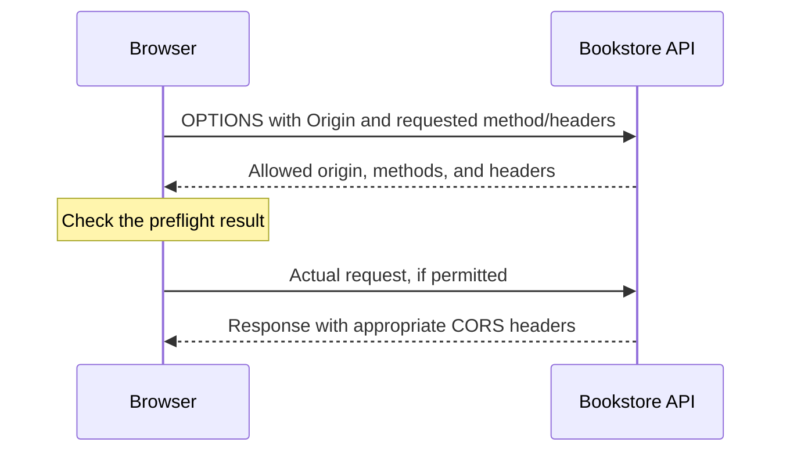

# HTTP — The Bookstore Learns to Correspond

*Post 3 of 31 · [Series index](README.md)*

Our bookstore has a server. This is encouraging, although having a telephone does not, by itself, make anyone good at conversation.

HTTP gives the browser and server a shared way to ask questions, send information, and report what happened. Understanding it turns a mysterious failed checkout into a message we can inspect.

This post develops the topics in Sriniously’s HTTP lesson using our bookstore. The examples are illustrative, and the protocol details are checked against the references below.

## A request needs enough context

HTTP uses a request-and-response model. A client initiates an exchange, and the server returns a response. The protocol is stateless, so an earlier request does not automatically establish the identity or meaning of a later one. Applications add continuity through cookies, sessions, tokens, and stored data.

For our bookstore, a request to view an order needs enough information to identify the order and establish the caller’s access. HTTP statelessness does not prevent us from storing the order or maintaining a session.

HTTPS protects HTTP communication using TLS. Encryption, integrity checks, and certificate-based server authentication help protect data in transit. SSL is the older predecessor to TLS. The familiar phrase “SSL certificate” persists rather longer than the technology it originally described. [HTTP overview](https://developer.mozilla.org/en-US/docs/Web/HTTP/Guides/Overview)

## Read the envelope before the contents

Here is an illustrative HTTP/1.1 request. The host is fictional.

```http
GET /books/42 HTTP/1.1
Host: api.example.com
Accept: application/json
```

The method expresses the requested operation. The target identifies the resource. Headers supply metadata and preferences. A blank line separates headers from an optional body. Responses have their own status and headers.

```http
HTTP/1.1 200 OK
Content-Type: application/json
Cache-Control: private, max-age=60

{"id":42,"title":"The Patient Bookseller"}
```

HTTP/2 and HTTP/3 carry the same core semantics using different wire formats. Reading a text representation in developer tools is useful even when that display does not reproduce the bytes on the network. [HTTP messages](https://developer.mozilla.org/en-US/docs/Web/HTTP/Guides/Messages)

## Methods describe the operation

| Method | A bookstore example | Intended meaning |
| --- | --- | --- |
| GET | `/books/42` | Retrieve a representation |
| HEAD | `/books/42` | Retrieve response metadata without the response body |
| POST | `/orders` | Submit an order for processing |
| PUT | `/reading-lists/7` | Create or replace the state at this target |
| PATCH | `/reading-lists/7` | Apply a set of changes |
| DELETE | `/reading-lists/7` | Remove the target’s association with its current functionality |
| OPTIONS | `/orders` | Ask about communication options |

**Safe** methods have essentially read-only semantics. **Idempotent** means repeating an identical request has the same intended server effect as making it once. It does not promise identical response bodies or status codes. A second DELETE might report that the list is already gone.

POST and PATCH are not guaranteed to be idempotent. An order API can add an idempotency-key mechanism to make a retried submission safe from duplicate processing. Merely naming the method POST does not implement that protection. [HTTP semantics](https://www.rfc-editor.org/rfc/rfc9110.html)

## Headers carry useful instructions

| Header | What we use it for |
| --- | --- |
| `Accept` | Response media types the client can handle |
| `Content-Type` | The media type of the message content |
| `Authorization` | Credentials for the request |
| `Cookie` / `Set-Cookie` | Sending and setting browser cookies |
| `Cache-Control` | Rules for caching a response |
| `ETag` | A validator associated with a representation |
| `Content-Encoding` | An applied coding such as gzip |
| `Content-Length` | Content length in bytes when supplied |
| `Location` | A destination associated with creation or redirection |

The distinction between `Accept` and `Content-Type` is particularly useful. A customer can send JSON while asking for a response in another supported format. One header describes the outgoing content, and the other expresses a preference about the reply. [Header reference](https://developer.mozilla.org/en-US/docs/Web/HTTP/Reference/Headers)

Security headers also influence browser behavior. HSTS supports HTTPS enforcement, Content Security Policy constrains content loading and execution, and framing policies help address clickjacking. Cookie attributes govern cookie handling. Headers work alongside application security controls. They do not make an unsafe order operation safe by appearing in sufficient numbers. [OWASP secure headers](https://owasp.org/www-project-secure-headers/)

## CORS explains a particular kind of browser failure

Suppose the shop runs at `https://shop.example.com` and its API at `https://api.example.com`. They have different origins. An origin comprises the scheme, hostname, and port.

For some cross-origin requests, the browser sends the request directly and checks whether the response permits JavaScript access. For others, it first sends an OPTIONS preflight asking whether the intended method and headers are allowed.



A cross-origin JSON POST or a request with an Authorization header generally requires preflight. An `Accept: application/json` preference alone is different from sending `Content-Type: application/json`.

The important response headers include `Access-Control-Allow-Origin`, `Access-Control-Allow-Methods`, and `Access-Control-Allow-Headers`. `Access-Control-Max-Age` can permit preflight-result caching, subject to browser limits. Credentialed requests require additional care, including an explicit allowed origin rather than `*`.

CORS is enforced by browsers. A successful request in an API client does not establish that browser JavaScript may read the same response. Authentication and authorization remain separate checks. [CORS guide](https://developer.mozilla.org/en-US/docs/Web/HTTP/Guides/CORS)

## A status code should tell the truth

| Family | Meaning | Useful examples |
| --- | --- | --- |
| 1xx | Informational | 100 Continue, 101 Switching Protocols |
| 2xx | Success | 200 OK, 201 Created, 204 No Content |
| 3xx | Redirection and conditional response handling | 301, 302, 304 Not Modified |
| 4xx | A problem associated with the request | 400, 401, 403, 404, 405, 409, 429 |
| 5xx | Server or upstream failure | 500, 501, 502, 503, 504 |

For the shop, malformed input can receive 400. Missing or invalid authentication can receive 401, with the required authentication challenge where applicable. A forbidden operation can receive 403. A missing book can receive 404. A conflicting update can receive 409, and rate limiting can produce 429.

An upstream invalid response differs from an upstream timeout, which is why gateways distinguish 502 and 504. A 501 response indicates unsupported functionality. It makes no promise that someone has scheduled the implementation for next Thursday. [Status code reference](https://developer.mozilla.org/en-US/docs/Web/HTTP/Reference/Status)

## Caching has two different questions

First, is the stored response still fresh? A suitable `max-age` can let a cache reuse it without another request.

Second, if it needs revalidation, has the representation changed? The client can send `If-None-Match` with its stored ETag. The server can return 304 without a new representation body, or 200 with updated content. `Last-Modified` and `If-Modified-Since` provide date-based validation. When both conditional mechanisms are present, their precedence matters.

`no-cache` permits storage but requires validation before reuse. `no-store` directs caches not to store the response. Private account pages and public catalog pages need different policies. Application caches and HTTP caches also have different responsibilities, so adopting a frontend query library does not remove the need to understand response caching. [HTTP caching](https://developer.mozilla.org/en-US/docs/Web/HTTP/Guides/Caching)

## Negotiate the representation and reduce the transfer

Clients can express preferences using `Accept`, `Accept-Language`, and `Accept-Encoding`. Servers describe the chosen representation in their response. When a cacheable response changes according to request headers, an appropriate `Vary` header helps caches distinguish variants.

Compression reduces transferred bytes when content compresses well. Textual catalog data may benefit considerably. An already compressed cover image may benefit much less. The actual savings depend on the content and coding, so I would measure our catalog rather than borrow another application’s percentage. [Content negotiation](https://developer.mozilla.org/en-US/docs/Web/HTTP/Guides/Content_negotiation)

## Connections, uploads, and streams

HTTP/1.1 uses persistent connections by default. HTTP/2 multiplexes streams over a TCP connection. HTTP/3 uses QUIC over UDP, avoiding TCP’s cross-stream head-of-line blocking. These transport improvements preserve the application-level meaning of methods and status codes. [HTTP evolution](https://developer.mozilla.org/en-US/docs/Web/HTTP/Guides/Evolution_of_HTTP)

For a cover upload, `multipart/form-data` can carry file content alongside ordinary fields. Boundaries separate the form parts. Multipart does not mean a file has automatically been split into resumable upload chunks. When sending browser FormData, let the browser set the Content-Type and boundary. [FormData guide](https://developer.mozilla.org/en-US/docs/Web/API/XMLHttpRequest_API/Using_FormData_Objects)

For ongoing progress updates, server-sent events use `text/event-stream`. Several events can arrive on one HTTP response, and the browser can reconnect after interruption. This is one streaming mechanism. It is distinct from HTTP/1.1 chunked transfer encoding and from ordinary large-file downloads. [Server-sent events](https://developer.mozilla.org/en-US/docs/Web/API/Server-sent_events/Using_server-sent_events)

## What I would inspect when checkout fails

I would read the method and target, request headers, payload, status, response headers, and body. Then I would check for preflight failures, stale cache behavior, and the timing of the exchange. The Network tab and an intercepting proxy make the conversation visible.

The bookstore still has plenty of ways to fail. We can at least ask it to put the complaint in writing.

Based on [Sriniously’s HTTP lesson](https://www.youtube.com/watch?v=a3C1DMswClQ), with original bookstore examples and clarifications from the linked documentation.

[Previous — How a Backend Works](02-how-a-backend-works.md) · [Next — Routing](04-routing.md) · [Series index](README.md)
