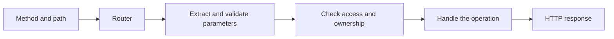

# Routing — Finding the Right Desk in the Bookstore

*Post 4 of 31 · [Series index](README.md)*

A customer asks for a book, and we send the request to the employee who resets passwords. This would be an unusual business strategy. It would also be a routing problem.

Routing connects an incoming request to the code responsible for handling it. Once HTTP gives us a method and target, the router determines which handler should receive the work.

This post follows the static routes, dynamic parameters, query strings, nesting, versioning, and fallback handling in Sriniously’s routing lesson. The bookstore contract below is an original example.

## The method matters as much as the path

| Request | Our handler’s responsibility |
| --- | --- |
| `GET /books` | List available books |
| `POST /books` | Create a catalog entry after permission checks |
| `GET /books/42` | Retrieve one book |
| `PATCH /books/42` | Apply an allowed update |
| `DELETE /books/42` | Remove the entry according to our catalog rules |

The first two requests share a path but have different methods. Routing must preserve that distinction. A matching route also does not, by itself, establish permission to perform the operation.

Frameworks provide different matching syntax. Express commonly uses `:bookId`, while other frameworks use forms such as `{book_id}` or `<book_id>`. The idea transfers across languages, but the punctuation may have its own travel arrangements. [Express routing guide](https://expressjs.com/en/guide/routing/)

## Static paths can return changing data

`/books` is a static path because its matching pattern has fixed segments. Its response can change every time the catalog changes.

For a dynamic path such as `/books/:bookId`, a request to `/books/42` yields a parameter value representing `42`. That value must be parsed and validated according to the endpoint’s contract before we use it. A numeric-looking path segment does not make the corresponding book exist.

Here is framework-neutral pseudocode rather than executable framework syntax.

```text
match GET /books/{bookId}
    validate bookId using the API contract
    retrieve the matching book
    return the book or a not-found response
```

I would also examine overlaps such as `/books/search` and `/books/:bookId`. Matching precedence differs between routers. Explicit constraints and deliberate registration order can prevent a search request from being interpreted as a particularly ambitious book identifier.

## Query parameters refine the request

Our catalog might support this URL.

```text
/books?category=history&page=2&limit=20&sort=title
```

The path identifies the collection. The query supplies filters, pagination, and ordering. Each field needs a documented meaning and limits. These choices belong to this bookstore API, rather than to an automatic behavior of HTTP.

For example, we can define page numbering to start at one, use 20 as the default limit, cap the limit at 100, and reject unknown sort values. If a query parameter repeats, the parser and API contract must determine whether that means a list or an error.

Use a URL builder to encode values rather than joining arbitrary user input into a URL. Spaces, ampersands, and other characters have structural meanings. A title containing an ampersand should remain a title, however strongly it feels about becoming a second parameter. [URLSearchParams](https://developer.mozilla.org/en-US/docs/Web/API/URLSearchParams)

GET request content has no generally defined semantics. Query parameters offer an interoperable way to express retrieval criteria. Query strings can also occur with other methods, so they are not exclusive to GET. [HTTP semantics](https://www.rfc-editor.org/rfc/rfc9110.html#section-9.3.1)

## Pagination is a contract, too

An illustrative response could look like this.

```json
{
  "data": [{"id": 42, "title": "The Patient Bookseller"}],
  "pagination": {"page": 2, "limit": 20, "total": 101, "totalPages": 6}
}
```

The client can use the metadata to offer navigation. The server must define what happens for an empty collection or an out-of-range page. Stable sorting also matters, especially when multiple books share a title. Later, we can compare page-based pagination with cursor-based approaches.

For now, I want a limit that bounds the response. Returning the whole inventory because the customer forgot a query parameter would be an excessively literal interpretation of helpfulness.

## Nesting expresses a relationship

```text
GET /customers/17/orders
GET /customers/17/orders/903
```

These paths express orders associated with customer 17. The second request identifies one order within that relationship.

The application must verify that order 903 belongs to customer 17 and that the caller may access it. Extracting both identifiers is only the beginning of that work. A plausible URL is not evidence of ownership.

Nesting can make relationships readable, but every database relationship does not need another path segment. `/orders/903` may be appropriate when the order has a global identity and the application enforces ownership separately. Choose the shape that supports the actual access pattern.



This diagram expresses responsibilities. The precise placement of middleware and handlers depends on the application.

## Versions give clients a migration window

Suppose the first catalog contract returns `name`, while a new contract requires `title`. Silently changing the existing response could break a reader app that still expects `name`.

We can support `/api/v1/books` and `/api/v2/books` while clients migrate. Document the differences, communicate a retirement date, and measure remaining use before removing the old contract. Keep version labels stable. Renaming v2 back to v1 after retirement would make the old address mean something different.

Versioning can use paths, headers, or media types. The operational responsibility is the same in each case. A client needs to know which contract it is using and what a migration requires. A new version is a commitment to maintain another interface for a period, rather than a decorative number to add whenever the code feels refreshed.

## Make unmatched requests understandable

If no route matches, return a deliberate not-found response with a consistent error shape. If a resource exists but the method is unsupported, 405 can be appropriate, including the Allow header required by HTTP semantics. Framework defaults vary, so inspect what the chosen router actually does. [HTTP status semantics](https://www.rfc-editor.org/rfc/rfc9110.html)

Fallback handling belongs after the intended routes where registration order controls matching. A single-page application’s HTML fallback also needs care around API paths. Returning an HTML page to a client expecting JSON turns one missing endpoint into a second, rather more confusing parsing error.

When I read an unfamiliar backend, its route table is a useful first map. It shows what the system offers, which inputs identify the work, and where the request enters the application. Next we need a common representation for the data that crosses that boundary.

Based on [Sriniously’s routing lesson](https://www.youtube.com/watch?v=SubuU1iOC2s). The contract choices, bookstore examples, and migration guidance are additional explanations.

[Previous — HTTP](03-http.md) · [Next — Serialization and Deserialization](05-serialization-and-deserialization.md) · [Series index](README.md)
