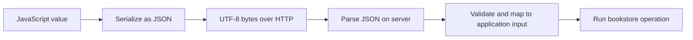

# Serialization — Getting a Book Through the Wire

*Post 5 of 31 · [Series index](README.md)*

Our browser has a JavaScript object representing a book. Our server might be written in Python, Go, Java, or Rust. Mailing the object’s memory address would be about as useful as telling a customer that their order is on my desk.

The two programs need a representation they can exchange and understand. Serialization supplies it.

Sriniously’s lesson introduces the problem through communication between different programming environments, then explores JSON and other formats. This post uses our bookstore to follow the conversion in both directions.

## Data moves through a shared representation

Serialization converts an application value into a representation suitable for transfer or storage. Deserialization interprets that representation and constructs values in the receiving program.



The server performs a corresponding conversion when it responds. The client then parses the response and uses the resulting values to render the page.

Serialization also matters for configuration, logs, saved documents, and messages between services. A value can need a stable representation even when it never crosses the public internet.

## JSON supplies a small vocabulary

```json
{
  "id": "book_42",
  "title": "The Patient Bookseller",
  "priceMinor": 1899,
  "currency": "USD",
  "available": true,
  "tags": ["fiction", "paperback"],
  "publisher": {"name": "Example Press"},
  "subtitle": null
}
```

JSON supports objects, arrays, strings, numbers, booleans, and null. Object names are strings enclosed in double quotes. Arrays are ordered sequences, and objects can contain nested structures. A top-level JSON value can also be a scalar, even though APIs frequently use objects or arrays.

JSON syntax excludes comments, trailing commas, and values such as `undefined`, `NaN`, and `Infinity`. Object names should be unique because duplicate-name handling varies across implementations. Networked JSON exchange uses UTF-8. [JSON standard](https://www.rfc-editor.org/rfc/rfc8259.html)

## A JavaScript object is not already JSON text

In the browser, `JSON.stringify` produces JSON text from a supported value. `JSON.parse` parses JSON text into JavaScript values. These are different operations from creating an ordinary object in memory.

```javascript
const book = { id: "book_42", title: "The Patient Bookseller" };
const text = JSON.stringify(book);
const decoded = JSON.parse(text);
```

Built-in objects and special values need attention. A Date is commonly serialized as a string. Object properties containing unsupported values can disappear, and circular references cause serialization to fail. Native BigInt values need an explicit representation rather than a direct stringify call. [JSON.stringify reference](https://developer.mozilla.org/en-US/docs/Web/JavaScript/Reference/Global_Objects/JSON/stringify)

The bookstore should define a response shape deliberately. Returning a database object wholesale makes every internal field a possible public disclosure, including fields we added yesterday and forgot about this morning.

## Follow one order submission

Consider an illustrative payload.

```json
{"items":[{"bookId":"book_42","quantity":2}]}
```

The browser serializes it and sends it with `Content-Type: application/json`. The server’s body parser reads the bytes and attempts to parse JSON. Successful parsing produces a structure that still needs validation.

```text
Received bytes
  → valid JSON?
  → expected object structure?
  → valid item identifiers and quantities?
  → permitted operation?
  → business rules and persistence
```

The response should also follow a defined contract, such as an order identifier and accepted status. The browser can inspect the HTTP status before choosing how to interpret the content. Browser `fetch` does not reject its promise merely because the server returns an HTTP error such as 404. [Fetch guide](https://developer.mozilla.org/en-US/docs/Web/API/Fetch_API/Using_Fetch)

## Parsing does not establish correctness

Both of these values are valid JSON.

```json
{"quantity":2}
```

```json
{"quantity":"two"}
```

Their syntax is valid, but our order contract accepts only an integer quantity within a defined range. Parsing answers whether the representation can be read. Validation answers whether the resulting input is acceptable.

Likewise, a title field that contains an unexpected object may parse successfully. A statically typed server does not automatically make arbitrary client input trustworthy. The decoding and validation behavior depends on the implementation and schema.

## Preserve meaning across languages

Our contract uses `priceMinor` as an integer amount in the stated currency’s minor units. That is a bookstore design choice. It avoids asking a binary floating-point value to serve as the entire financial policy of a business.

Other values need equally explicit conventions.

| Value | A contract decision worth making |
| --- | --- |
| Identifier | Use a string when arithmetic and numeric range are irrelevant |
| Timestamp | Specify an unambiguous format and timezone convention |
| Money | Specify currency, units, precision, and rounding |
| Optional field | Define how absence differs from explicit null |
| Collection | Define whether order and duplicates matter |

JavaScript’s exact integer range has limits. When another language can represent larger integers, serializing one as a JSON number can lose precision in a JavaScript consumer. A string representation may be appropriate for a large identifier. [JavaScript number precision](https://developer.mozilla.org/en-US/docs/Web/JavaScript/Reference/Global_Objects/Number/MAX_SAFE_INTEGER)

## Choose the format for the relationship

JSON is readable and broadly supported, making it convenient for our public bookstore API. XML and YAML provide other text formats with different rules and use cases. Binary formats such as Protocol Buffers offer another approach, including schema-based messages and generated code.

Protocol Buffers require careful schema evolution. Field numbers identify fields on the wire, and deleting a field does not make its old number safe to reuse. A smaller payload is useful only if both sides continue to agree on its meaning. [Protocol Buffers guide](https://protobuf.dev/programming-guides/proto3/)

Whichever representation we choose, the network ultimately carries bytes. The application needs the agreed encoding and schema. It does not need to manually construct Ethernet frames to send an order, which is fortunate because the customer is still waiting to buy a paperback.

Based on [Sriniously’s serialization lesson](https://www.youtube.com/watch?v=vzg90tY3uM0), with original contract examples and interoperability details from the linked references.

[Previous — Routing](04-routing.md) · [Next — Authentication and Authorization](06-authentication-and-authorization.md) · [Series index](README.md)
