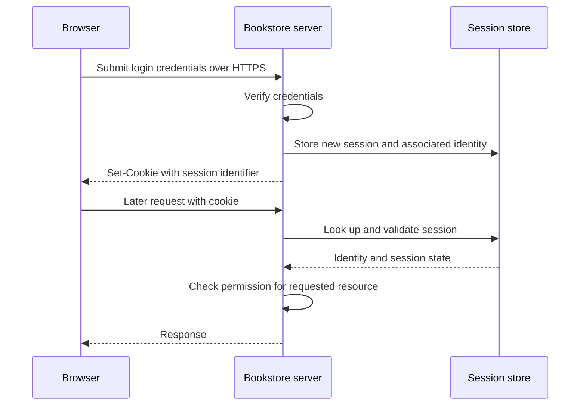

# Authentication and Authorization — Knowing the Customer, Checking the Keys

*Post 6 of 31 · [Series index](README.md)*

The bookstore now accepts requests, routes them, and understands their JSON. A customer can ask to see an order. Unfortunately, so can everyone else with a keyboard.

Two questions have become unavoidable. Who is making the request? Are they allowed to perform this operation on this particular resource?

Authentication establishes an identity in a context. Authorization evaluates permitted actions. Knowing that someone is a customer does not entitle them to inspect the accounts of every other customer, however promising that might look for the book club.

This post follows the sessions, cookies, JWTs, API keys, delegated access, roles, and security concerns in Sriniously’s lesson. The bookstore designs and current security clarifications are additional explanations.

## Trust needs evidence that travels

The lesson opens with a historical progression from personal recognition and physical tokens to shared secrets, digital passwords, cryptography, and multifactor authentication. The useful design question is how a verifier establishes identity when it cannot rely on recognizing a familiar face.

Authentication factors commonly involve something a person knows, possesses, or is. Two passwords are still the same factor category. Passwordless public-key systems and multifactor flows change the evidence used, while account recovery remains another route into the same identity.

For our shop, I want to understand the full lifecycle, including login, continued access, expiry, logout, and recovery. A successful login screen is only the opening ceremony.

## Sessions maintain server-side context

A conventional session flow works as follows.



The identifier should be unpredictable and generated securely. The session store might be a database or an appropriately configured shared store such as Redis. Multiple application instances need a consistent way to find and invalidate sessions.

Expiry is a server-enforced rule. An expired session does not automatically grant a new authenticated session. Session identifiers should also be renewed after authentication or privilege changes to reduce session-fixation risk. [Session management guidance](https://cheatsheetseries.owasp.org/cheatsheets/Session_Management_Cheat_Sheet.html)

## Cookies transport state under browser rules

Cookies can carry a session identifier or a token. They are a storage and transport mechanism, so choosing cookies does not, by itself, choose between sessions and JWTs.

An illustrative cookie for our same-site web application might be set like this.

```http
Set-Cookie: __Host-session=<opaque-random-value>; Path=/; Secure; HttpOnly; SameSite=Lax
```

`Secure` limits transmission to secure connections, while `HttpOnly` prevents access through ordinary JavaScript cookie APIs. `SameSite` affects cross-site sending. Domain and path rules further determine when cookies accompany requests. The `__Host-` prefix imposes restrictions including Secure, Path=/, and absence of a Domain attribute.

Cookie-based authentication still needs protection for state-changing operations, including an appropriate CSRF defense. HttpOnly reduces one avenue of theft but does not stop malicious page scripts from making requests in the user’s browser. [Cookie guidance](https://developer.mozilla.org/en-US/docs/Web/HTTP/Guides/Cookies)

## JWTs carry claims that must be verified

A commonly used signed JWT has three base64url-encoded components.

```text
header.payload.signature
```

The header supplies metadata such as the algorithm. The payload contains claims, which may include a subject, issuer, audience, and expiry. The signature allows verification of integrity and issuer authenticity under the configured key and algorithm.

Decoding the payload does not verify it. Signing also does not encrypt its contents, so sensitive data should not be included on the assumption that base64url makes it secret.

A verifier needs deliberate algorithm constraints, correct key selection, issuer and audience checks, and time-claim handling. Symmetric signing shares a secret with verifiers. Asymmetric signing uses a private signing key and public verification keys. A mature library helps implement these rules. [JWT best practices](https://www.rfc-editor.org/rfc/rfc8725.html)

## Stateless verification has lifecycle tradeoffs

A self-contained token can let application instances verify claims without looking up a session on each request. That is useful when several services need a common, verifiable credential.

It also raises a practical question for the bookstore. What happens if an employee’s privileges are removed while their token is still valid?

Short access-token lifetimes limit the window. Revocation lists, token-version checks, introspection, and other stateful controls can provide earlier invalidation. Refresh-token management can govern continued issuance. Each choice has storage, latency, and operational costs. Rotating every signing key to remove one customer would affect many other customers, which makes it a remarkably sociable way to solve a private problem.

Removing a browser’s token at logout is different from making a copied token unusable. The policy needs to address both.

| Design | Useful property | Responsibility to plan for |
| --- | --- | --- |
| Shared server sessions | Central invalidation and session control | Store availability and cross-instance consistency |
| Self-contained access tokens | Local verification across services | Expiry, validation, key management, and revocation needs |
| Hybrid system | Different controls for different interactions | Clear lifecycle and consistent enforcement |

These are architectural choices rather than a ranking of fashionable credentials. A JWT can even participate in a stateful system. Its format does not dictate the entire authentication architecture.

## API keys identify programmatic clients

Suppose a stock-management integration needs to update availability. It should receive its own scoped credential, rather than borrow the owner’s interactive login session.

An API key can identify the integration and associate it with permissions, quotas, and audit records. Generate it securely, expose it carefully, support rotation and revocation, and keep it out of public source code and URLs. A private server credential belongs on the server side of our integration. Whoever obtains a bearer credential may be able to exercise its permissions.

Machine-to-machine communication can also use OAuth client credentials or other authentication schemes. It does not inherently require an API key. [REST security guidance](https://cheatsheetseries.owasp.org/cheatsheets/REST_Security_Cheat_Sheet.html)

## OAuth delegates access, and OIDC supplies identity

If a customer lets the shop connect to another service, asking for that service’s password would grant far more power than the feature needs.

OAuth defines delegated access using tokens and scopes. Its core roles include the resource owner, client, authorization server, and resource server. The client requests permission, the authorization server handles the grant, and the resource server evaluates access tokens for the protected resource.

OpenID Connect adds an identity layer on OAuth 2.0. Its ID token describes the authenticated end user for the client. An access token serves a different purpose at the resource server. They should not be swapped merely because both happen to look like strings. [OpenID Connect specification](https://openid.net/specs/openid-connect-core-1_0.html)

For an authorization-code flow with PKCE, the browser is redirected to the provider. Following authentication and consent, it returns with a code. The client exchanges the code and code verifier at the authorization server’s token endpoint, then validates the resulting tokens. State, nonce where applicable, and strict redirect handling protect the flow.

The implicit flow is discouraged. Client credentials serve machine clients, while device authorization supports input-constrained devices through a different interaction. Use a maintained provider or library and follow current guidance for the client type. [OAuth security best practice](https://datatracker.ietf.org/doc/html/rfc9700)

## Authorization goes beyond the role name

Our bookstore might have customers, catalog editors, and administrators.

| Operation | Example policy |
| --- | --- |
| Read the public catalog | Public access |
| View an order | Its customer or an authorized support role |
| Edit a description | Catalog editor or administrator |
| Change another employee’s role | Explicit administrative permission |

Role-based access control groups permissions into roles. The application must still check resource ownership, organization boundaries, and relevant conditions. Giving someone the customer role does not establish that order 903 belongs to them.

Enforce authorization on the server for each operation and deny access unless the applicable policy allows it. A hidden admin button helps presentation, while the actual permission check belongs at the protected operation. [Authorization guidance](https://cheatsheetseries.owasp.org/cheatsheets/Authorization_Cheat_Sheet.html)

## Passwords and failure responses deserve care

Store passwords using a suitable password-hashing algorithm with salts and an appropriate work factor. Argon2id is a current recommended option. Use a vetted password-verification function. Reversible encryption or a fast general-purpose hash alone is unsuitable for ordinary password storage. [Password storage guidance](https://cheatsheetseries.owasp.org/cheatsheets/Password_Storage_Cheat_Sheet.html)

Login errors should avoid revealing whether a particular account exists. A generic failure message helps, but response status and timing can also leak information. A missing-user branch that skips expensive password verification may behave observably differently from a wrong-password branch.

Use maintained authentication components and consistent verification paths, along with throttling, monitoring, and suitable multifactor controls. Adding an arbitrary fixed sleep does not prove the whole authentication system is timing-safe. [Authentication guidance](https://cheatsheetseries.owasp.org/cheatsheets/Authentication_Cheat_Sheet.html)

I can use an implementation exercise to understand these mechanisms, while recognizing that production authentication requires maintained libraries, lifecycle design, and ongoing review. The shop’s customers have come for books. They have not volunteered to become supporting characters in an account-security experiment.

Based on [Sriniously’s authentication and authorization lesson](https://www.youtube.com/watch?v=A95rliroC8Q), with current standards and original bookstore examples.

[Previous — Serialization and Deserialization](05-serialization-and-deserialization.md) · [Next — Validation and Transformation](07-validation-and-transformation.md) · [Series index](README.md)
